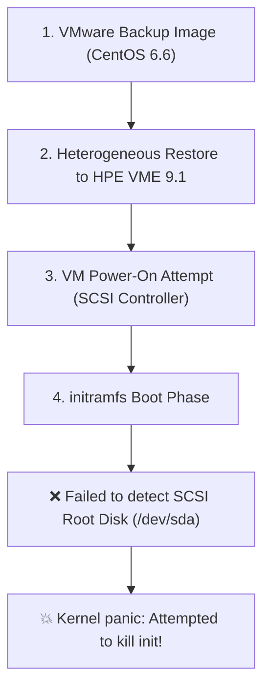
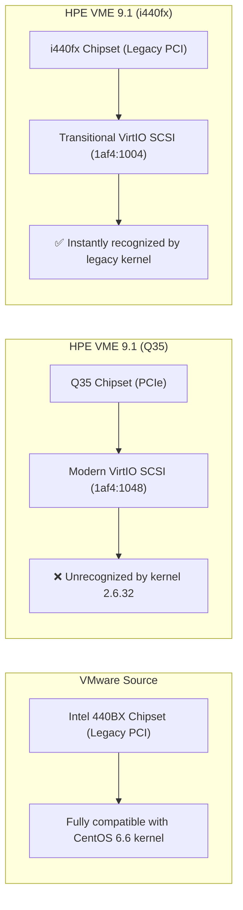

Enterprise datacenters are increasingly executing V2V (Virtual-to-Virtual) migrations from VMware vSphere environments to KVM-based next-generation private clouds such as **HPE VM Essentials (VME)**.

While modern Linux distributions (RHEL 8/9, Rocky, Ubuntu 22.04+) transition smoothly due to native KVM hypervisor and VirtIO driver maturity, legacy operating systems such as **RHEL/CentOS 6.x** remain widely deployed for proprietary business applications and legacy databases.

During a recent heterogeneous restore of a legacy **CentOS 6.6 VM** into **HPE VME 9.1** using **Veeam Backup & Replication**, the guest OS failed to boot, crashing immediately into a fatal kernel panic.

This article details the step-by-step field investigation—including emergency maintenance mode access, virtual disk controller differences (SATA vs. SCSI), VirtIO PCI driver module binding, and QEMU machine types (Q35 vs. i440fx)—and documents the final resolution achieved via the **Veeam Backup & Replication v13** engine.

---

### 1. Workload Scope and Target Environment

The target workload was a legacy development database server equipped with an OS disk and multiple large data disks organized into LVM volume groups (VG01, VG02).

| Component | Source Environment (Existing) | Target Environment (Restore) | Remarks |
| :--- | :--- | :--- | :--- |
| **Hypervisor** | VMware vSphere ESXi | **HPE VME 9.1 (KVM)** | Latest VME 9.1 platform |
| **Guest OS** | CentOS 6.6 (64-bit) | CentOS 6.6 (64-bit) | Legacy enterprise Linux |
| **Kernel Version** | 2.6.32-504.el6.x86_64 | 2.6.32-504.el6.x86_64 | Upstream RHEL 6.6 kernel |
| **Boot Mode** | Legacy BIOS | Legacy BIOS | MBR partition table |
| **Machine Type** | Intel 440BX family | **Q35 (PCIe based)** | Virtual chipset topology difference |
| **Backup Solution** | Veeam Backup & Replication 12.3 | **Veeam B&R v13 (Latest)** | Entire VM image restore |
| **Disk Topology** | 1 OS Disk + Multiple Data Disks | Multi-volume LVM (VG01, VG02) | Multi-disk production setup |

---

### 2. Incident Symptoms: Instant Kernel Panic on Boot

Following an Entire VM Restore from VMware backup images to the HPE VME 9.1 cluster, the virtual machine was powered on. 

Immediately following the GRUB bootloader phase, the kernel failed to mount the root block device, halting the system with the following panic message on the virtual console:



```text
Kernel panic - not syncing: Attempted to kill init!
Pid: 1, comm: init Not tainted 2.6.32-504.el6.x86_64 #1
Call Trace:
 [<ffffffff815274d3>] ? panic+0xa7/0x16f
 [<ffffffff81074a32>] ? do_exit+0x862/0x870
 [<ffffffff811894d5>] ? fput+0x25/0x30
 [<ffffffff81074aba>] ? do_group_exit+0x5a/0xd0
 [<ffffffff81074b47>] ? sys_exit_group+0x17/0x20
 [<ffffffff8100b072>] ? system_call_fastpath+0x16/0x1b
```



#### Why "Attempted to kill init!" Occurs
During early userspace boot, the `initramfs` ramdisk initializes required storage drivers, mounts the root filesystem (`/`), and pivots execution to PID 1 (`init`). 

Because the SCSI boot device was invisible to the kernel, root mounting failed completely. When the startup script encountered a fatal error and exited, PID 1 terminated, causing the kernel to trigger an immediate panic.

---

### 3. Step-by-Step Triage and Root Cause Analysis

#### Step 1. Changing the OS Disk Interface from SCSI to SATA
To isolate whether the issue stemmed from filesystem corruption or virtual disk controller incompatibility, the boot disk interface was switched from **SCSI to SATA** via the VME management console.

* **Result**: **The OS booted successfully without a kernel panic.**
* **Observation**: While the OS kernel booted, the remaining data disks attached to the SCSI controller remained undetected. As a result, filesystems defined in `/etc/fstab` failed to mount, dropping the server into **Maintenance Mode**.
* **Takeaway**: The underlying CentOS 6.6 filesystem was intact; the issue was localized to **KVM SCSI controller and driver incompatibility**.

#### Step 2. Investigating VirtIO Driver Modules
From the maintenance mode shell, kernel version, PCI topology, and module states were verified:

```bash
# Check kernel version
uname -r
# 2.6.32-504.el6.x86_64

# Inspect PCI devices and kernel driver bindings
lspci -nnk

# Check loaded VirtIO modules
lsmod | grep virtio

# Attempt manual module insertion
modprobe virtio_pci
modprobe virtio_blk
modprobe virtio_scsi

# Inspect block device recognition
lsblk
fdisk -l
```

The investigation showed that `virtio_pci` and `virtio_scsi` kernel modules existed within the OS and could be loaded manually via `modprobe`. However, even with modules loaded, the kernel **failed to bind the driver to the SCSI controller presented by the KVM hypervisor**.

#### Step 3. Architectural Limits of SATA Controllers
Switching all attached data disks to SATA was evaluated as a temporary workaround. 

However, KVM hypervisor specifications impose a **hard limit of 6 SATA disks per virtual machine**. Even with auxiliary SATA buses, enterprise database servers spanning multiple LVM volume groups (VG01, VG02) exceeded this capacity limit. Restoring native SCSI functionality was mandatory.

#### Step 4. Machine Type Mismatch and VirtIO PCI Device IDs
The fundamental root cause was identified in the **Machine Type** architecture difference between VMware ESXi and HPE VME (KVM).

Hardware topology on the source VMware VM was audited:

```bash
# Verify BIOS and motherboard specifications
dmidecode -t 0
dmidecode -t 2
```

The source VMware VM utilized the legacy **Intel 440BX chipset family (`440bx`)**. Conversely, modern KVM in HPE VME 9.1 defaults to the PCIe-based **Q35** machine type.



#### VirtIO PCI Device ID Matrix
KVM exposes different PCI device IDs depending on the selected virtual machine type:

| Device Type | PCI Vendor:Device ID | Specification | CentOS/RHEL 6.6 Kernel (2.6.32) Support |
| :--- | :--- | :--- | :--- |
| **VirtIO Block (Legacy)** | `1af4:1001` | Transitional (Legacy PCI) | **Supported (Functional)** |
| **VirtIO Block (Modern)** | `1af4:1042` | VirtIO 1.0+ (Modern PCIe) | Not Supported |
| **VirtIO SCSI (Legacy)** | **`1af4:1004`** | **Transitional (i440fx)** | **Supported (Functional ⭐️)** |
| **VirtIO SCSI (Modern)** | **`1af4:1048`** | **VirtIO 1.0+ (Q35)** | **Not Supported (Kernel Panic ❌)** |

* **Q35 Machine Type**: Exposes Modern VirtIO SCSI `1af4:1048`. Released in 2014, the CentOS 6.6 kernel (`2.6.32-504`) predates the VirtIO 1.0 specification and cannot bind to this modern device ID.
* **i440fx Machine Type**: Emulates a classic PCI bus and presents the transitional/legacy VirtIO SCSI ID `1af4:1004`, allowing legacy in-tree drivers to bind immediately.

---

### 4. Resolution via Veeam Backup & Replication v13

While manual controller and machine type adjustments were evaluated, the issue was cleanly resolved by upgrading the backup and restore platform.

* **Initial Test Baseline**: Veeam Backup & Replication 12.3.2 (build 4165)
  * Generated disk controller binding incompatibilities during VMware-to-KVM virtual hardware translation.
* **Final Solution and Verification**:
  * The target CentOS 6.6 VM was freshly backed up using **Veeam Backup & Replication v13**.
  * The new image was restored directly to HPE VME 9.1.
  * **Result**: The VM booted cleanly without requiring manual SATA overrides. **All OS and LVM data disks were detected over SCSI, and database services resumed normal operation.**

```bash
# Verify post-restore disk and LVM integrity
pvs
vgs
lvs

# Verify filesystem mounts
df -hT

# Confirm database daemon and listener ports
ps -ef | grep mysql
netstat -tulpn
```

Veeam v13 incorporates improved heterogeneous migration heuristics for KVM targets, correctly identifying legacy guest OS profiles and presenting compatible virtual hardware topologies out of the box.

---

### 5. Production Field Checklist

When restoring legacy Linux workloads from VMware to HPE VME or KVM-based platforms:

1. **Emergency Maintenance Access**:
   * Temporarily map the boot disk to `SATA` to bypass SCSI panics and inspect internal system configuration from maintenance mode.
2. **Machine Type Alignment (Q35 vs. i440fx)**:
   * For RHEL/CentOS 6.x (kernel 2.6.32), ensure the hypervisor presents legacy PCI (`i440fx`) rather than PCIe (`q35`) to expose `1af4:1004`.
3. **Backup Engine Currency**:
   * Keep backup platforms updated. Engine updates such as Veeam v13 significantly enhance virtual hardware abstraction and controller translation during V2V operations.
4. **End-to-End Validation**:
   * Verify beyond basic OS boot: validate LVM volume group activation, `/etc/fstab` mounts, and application database services.
