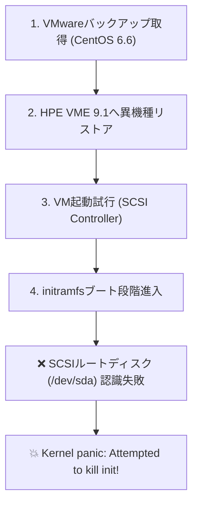
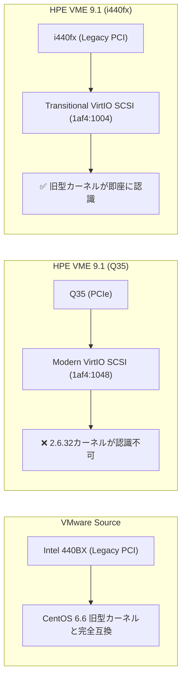

エンタープライズデータセンターの現場において、既存のVMware vSphere環境からKVMベースの次世代プライベートクラウドである**HPE VM Essentials (VME)** への移行（V2V）プロジェクトが本格化しています。

最新のLinuxディストリビューション（RHEL 8/9、Rocky、Ubuntu 22.04など）はKVMおよびVirtIOドライバーとの親和性が高くスムーズに復旧可能ですが、レガシーな業務システムやデータベースの都合によりアップデートできない**旧世代OS（RHEL/CentOS 6.x系）** も依然として現場で稼働しています。

先日正式リリースされた**HPE VME 9.1**環境において、旧型カーネルを搭載した**CentOS 6.6 VM**を**Veeam**で異機種リストア（Restore）したところ、起動直後に致命的なカーネルパニック（Kernel Panic）が発生して停止する障害が発生しました。

緊急メンテナンスモードへの移行、仮想ディスクコントローラー（SATA vs SCSI）、VirtIO PCIドライバーモジュール、QEMUマシンタイプ（Q35 vs i440fx）の深層調査を行い、**Veeam Backup & Replication v13**最新エンジンによって正常稼働に至った実務トラブルシューティングの全工程を記録します。

---

### 1. 対象環境および構成概要

復旧対象のVMはレガシーな開発用データベース（DB）サーバーであり、OSディスクと複数のLVMボリュームグループ（VG01、VG02）に分かれた大容量データディスクを保持していました。

| 項目 | 移行元環境（Source） | 移行先環境（Target） | 備考 |
| :--- | :--- | :--- | :--- |
| **ハイパーバイザー** | VMware vSphere ESXi | **HPE VME 9.1 (KVM)** | 最新VME 9.1スタック |
| **Guest OS** | CentOS 6.6 (64-bit) | CentOS 6.6 (64-bit) | レガシーLinux |
| **カーネルバージョン** | 2.6.32-504.el6.x86_64 | 2.6.32-504.el6.x86_64 | 旧型2.6.32リリース |
| **ブート方式** | Legacy BIOS | Legacy BIOS | MBRパーティション |
| **マシンタイプ** | Intel 440BX系 | **Q35 (PCIeベース)** | 仮想チップセット差異 |
| **バックアップ製品** | Veeam Backup & Replication 12.3 | **Veeam B&R v13 (最新)** | VMイメージ復旧 |
| **ディスク構成** | OSディスク 1本 + データディスク 複数 | LVM (VG01, VG02) マルチボリューム | 本番規模のディスク構成 |

---

### 2. 障害の初期症状：起動直後のKernel Panic

VMware上で取得したバックアップイメージをHPE VME 9.1クラスターへリストア（Entire VM Restore）し、仮想マシンの電源を投入しました。

GRUBブートローダー画面を通過してカーネルがロードされた瞬間、ルートディスクをマウントできず、コンソールに以下のカーネルパニックが出力されてシステムが完全に停止しました。

```text
Kernel panic - not syncing: Attempted to kill init!
Pid: 1, comm: init Not tainted 2.6.32-504.el6.x86_64 #1
Call Trace:
 [<ffffffff815274d3>] ? panic+0xa7/0x16f
 [<ffffffff81074a32>] ? do_exit+0x862/0x870
 [<ffffffff811894d5>] ? fput+0x25/0x30
 [<ffffffff81074aba>] ? do_group_exit+0x5a/0xd0
 [<ffffffff81074b47>] ? sys_exit_group+0x17/0x20
 [<ffffffff8100b072>] ? system_call_fastpath+0x16/0x1b
```



#### なぜ「Attempted to kill init!」が発生するのか？
Linuxのブートシーケンスにおいて、`initramfs`がストレージドライバーを読み込んでルートファイルシステム（`/`）をマウントし、PID 1の`init`プロセスへ制御を渡します。

しかしSCSIブートディスクがカーネル層で認識されずマウントに失敗したため、初期化スクリプトが異常終了し、プロセス1番（`init`）が死んだことでカーネルがシステムを非常停止（Panic）させた構造です。

---

### 3. 段階的な原因分析および検証（Triage）

#### Step 1. OSディスクコントローラーをSCSIからSATAへ変更
OS自体の破損か、仮想ストレージコントローラーの非互換かを切り分けるため、VME管理コンソール上でブートディスクのインターフェースを**SCSIからSATAへ変更**しました。

* **結果**: **Kernel Panicが発生せずOSの基本起動に成功！**
* **現象**: OSは起動したものの、SCSIコントローラーに接続されていた残りのデータディスク群が認識されず、`/etc/fstab`のマウントポイントが見つからないため**メンテナンスモード（Maintenance Mode）** に突入しました。
* **示唆**: CentOS 6.6イメージ自体の問題ではなく、**KVMのSCSIコントローラーおよびドライバーの互換性問題**であることが明確になりました。

#### Step 2. VirtIOドライバーモジュールの確認
メンテナンスシェル上でカーネルおよびPCIデバイスの認識状況を確認しました。

```bash
# カーネルバージョンの確認
uname -r
# 2.6.32-504.el6.x86_64

# PCIデバイスとバインド状況の確認
lspci -nnk

# VirtIOモジュールの確認
lsmod | grep virtio

# 手動でモジュールをロード
modprobe virtio_pci
modprobe virtio_blk
modprobe virtio_scsi

# ディスク認識確認
lsblk
fdisk -l
```

調査の結果、`virtio_pci`および`virtio_scsi`カーネルモジュール自体はOS内に存在しロード可能でした。しかし、モジュールを有効化しても**KVMハイパーバイザーが提供するSCSIコントローラーへドライバーが自動バインド（Binding）されない現象**が確認されました。

#### Step 3. SATA全変更の限界
暫定対処として全ディスクをSATAへ変更する構成を検討しました。

しかし、KVM仮想マシンのハードウェア仕様上、**1台のVMに接続可能なSATAディスクは最大6本に制限**されています。SATAバスを追加しても制限を回避できず、複数のLVMボリューム（VG01、VG02）で構成された本番DBサーバーの全ディスクを収容することは不可能でした。したがって**SCSIの正常化が必須**でした。

#### Step 4. マシンタイプ（Machine Type）とVirtIO PCI IDの不一致
根本原因はVMwareとHPE VME（KVM）における**仮想マシンタイプ（Machine Type）の差異**にありました。

移行元VMware VMのDMI情報を確認しました：

```bash
# BIOSおよびベースボード情報の確認
dmidecode -t 0
dmidecode -t 2
```

VMware ESXi環境は旧来の**Intel 440BX系（`440bx`）** チップセットトポロジーをエミュレートしていました。一方、HPE VME 9.1のKVMはデフォルトで最新PCIeバスを採用する**Q35**マシンタイプを使用しています。



#### VirtIO PCI Device ID対照表
KVM環境では、マシンタイプによってVirtIOコントローラーのPCI IDが変化します：

| デバイス区分 | PCI Vendor:Device ID | 仕様区分 | CentOS/RHEL 6.6 カーネル(2.6.32) 対応 |
| :--- | :--- | :--- | :--- |
| **VirtIO Block (Legacy)** | `1af4:1001` | Transitional (レガシーPCI) | **対応（正常動作）** |
| **VirtIO Block (Modern)** | `1af4:1042` | VirtIO 1.0+ (Modern PCIe) | 非対応 |
| **VirtIO SCSI (Legacy)** | **`1af4:1004`** | **Transitional (i440fx)** | **対応（正常動作 ⭐️）** |
| **VirtIO SCSI (Modern)** | **`1af4:1048`** | **VirtIO 1.0+ (Q35)** | **非対応（Kernel Panic ❌）** |

* **Q35マシンタイプ**: Modern VirtIO SCSI規格である`1af4:1048`を提示します。2014年リリースのCentOS 6.6カーネル（`2.6.32-504`）はVirtIO 1.0策定前の古い仕様のため、このIDを認識できません。
* **i440fxマシンタイプ**: 従来のPCIバスエミュレーションにより、下位互換性のあるTransitional VirtIO SCSI ID `1af4:1004`を提示するため、旧型ドライバーがディスクを即座に認識できます。

---

### 4. 最終解決：Veeam Backup & Replication v13による解決

現場でのマシンタイプ検証と並行し、**バックアップ製品の最新エンジンアップデート**によって問題が根本解決しました。

* **初期検証**: Veeam Backup & Replication 12.3.2 (ビルド 4165)
  * VMwareからKVMへの異機種変換処理において、旧型Linuxカーネル向けのコントローラーバインド不整合が発生。
* **最終対応と復旧成功**:
  * **Veeam Backup & Replication v13 最新バージョン**環境にて、対象CentOS 6.6 VMのイメージバックアップを新規取得。
  * HPE VME 9.1環境へ新規リストアを実施。
  * **結果**: 手動でSATAに変更することなく、**起動時のKernel Panicが解消され、OSおよび全LVMデータディスクがSCSI経由で完全認識され正常稼働に成功！**

```bash
# 復旧後のLVMおよびディスク認識確認
pvs
vgs
lvs

# ファイルシステムのマウント確認
df -hT

# データベースプロセスの稼働確認
ps -ef | grep mysql
netstat -tulpn
```

Veeam v13の最新移行エンジンは、復旧先KVMハイパーバイザー上にVMプロファイルを生成する際、レガシーOSの種別をより的確に識別し、互換性の高い仮想ハードウェアレイヤーを自動構成するよう最適化されていることが実証されました。

---

### 5. 実務チェックリスト

VMwareからHPE VME（またはKVMベースのHCI）へ旧型Linuxを異機種復旧する際は、以下のステップを確認してください：

1. **緊急調査モードの確保**:
   * ブートディスクを一時的に`SATA`へ変更してリストアすることで、Kernel Panicを回避してメンテナンスモードに入り、内部構成を調査できます。
2. **マシンタイプ（Q35 vs i440fx）の適合**:
   * RHEL/CentOS 6.x（2.6.32カーネル）等のレガシー環境では、PCIeベースの`q35`ではなくレガシーPCIである`i440fx`を選択し、`1af4:1004`を提示させます。
3. **バックアップ製品バージョンの最新化**:
   * 異機種V2V復旧は仮想ハードウェアの抽象化が肝となります。旧バージョンで認識障害が発生する場合は、Veeam v13等最新のバックアップエンジンで再取得・復旧することが確実な解決策となります。
4. **サービス稼働の総合検証**:
   * 単なるブート成功に留まらず、マルチディスクのLVM活性化、`/etc/fstab`マウント、DBデーモンの起動まで確実に検証してください。
