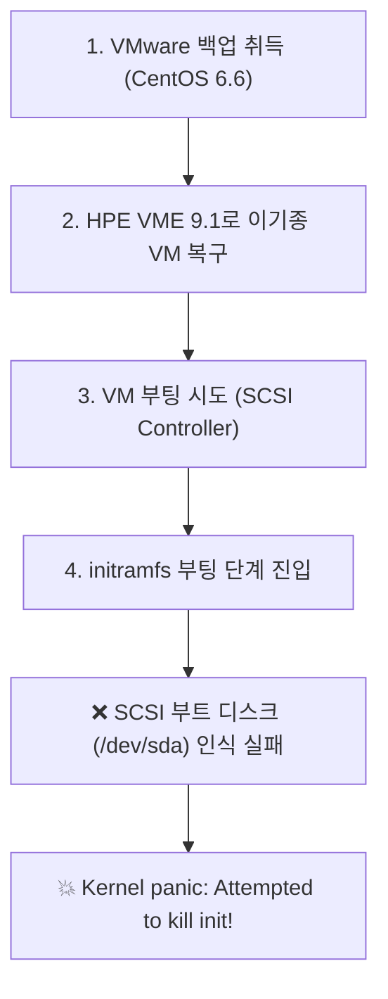
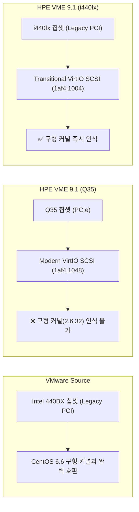

엔터프라이즈 데이터센터 현장에서 VMware 가상화 환경을 KVM 기반의 차세대 프라이빗 클라우드인 **HPE VM Essentials(VME)** 로 전환(V2V)하는 프로젝트가 활발히 진행되고 있습니다. 

최신 Linux 배포판(RHEL 8/9, Rocky, Ubuntu 22.04+)은 KVM 하이퍼바이저와 VirtIO 드라이버 간 호환성이 완벽하여 별다른 이슈 없이 원활하게 복구되지만, 현장에는 여전히 비즈니스 로직이나 레거시 데이터베이스 때문에 업그레이드하지 못한 **구형 OS(RHEL/CentOS 6.x 계열)** 가 반드시 존재합니다.

최근 전격 릴리즈된 **HPE VME 9.1** 환경에서 구형 커널을 탑재한 **CentOS 6.6 VM**을 백업 및 복구 솔루션인 **Veeam**을 통해 이기종 복구(Restore)하는 과정에서 부팅 즉시 커널 패닉이 발생하며 뻗어버리는 치명적인 장애가 발생했습니다.

현장에서 긴급 메인터넌스 모드로 진입하여 가상 디스크 컨트롤러(SATA vs SCSI), VirtIO PCI 드라이버 모듈, QEMU 머신타입(Q35 vs i440fx)을 심층 분석하고, **Veeam Backup & Replication v13** 최신 엔진을 통해 최종 정상 가동에 성공한 실무 트러블슈팅 전 과정을 상세히 기록합니다.

---

### 1. 작업 대상 및 환경 개요

복구 대상 VM은 레거시 개발 데이터베이스(DB) 서버로, OS 및 복수의 LVM 볼륨 그룹(VG01, VG02)으로 분리된 대용량 데이터 디스크를 보유하고 있었습니다.

| 구분 | Source 환경 (기존) | Target 환경 (복구지) | 비고 |
| :--- | :--- | :--- | :--- |
| **하이퍼바이저** | VMware vSphere ESXi | **HPE VME 9.1 (KVM)** | 최신 VME 9.1 스택 |
| **Guest OS** | CentOS 6.6 (64-bit) | CentOS 6.6 (64-bit) | 레거시 운영체제 |
| **커널 버전** | 2.6.32-504.el6.x86_64 | 2.6.32-504.el6.x86_64 | 구형 2.6.32 릴리즈 커널 |
| **부팅 방식** | Legacy BIOS | Legacy BIOS | MBR 파티션 |
| **머신타입** | Intel 440BX 계열 | **Q35 (PCIe 기반)** | 가상 하드웨어 칩셋 차이 |
| **백업 솔루션** | Veeam Backup & Replication 12.3 | **Veeam B&R v13 (최신)** | VM Image 백업 및 복구 |
| **디스크 구성** | OS 디스크 1개 + 데이터 디스크 다수 | LVM (VG01, VG02) 기반 멀티 볼륨 | 데이터 디스크 복수 할당 |

---

### 2. 최초 장애 증상: 부팅 즉시 Kernel Panic 발생

VMware 환경에서 정상 백업된 백업 이미지를 HPE VME 9.1 클러스터로 복구(Instant Recovery / Entire VM Restore)한 후 전원을 켰습니다. 

GRUB 부트로더 화면이 지나가고 커널이 로드되는 순간, 루트 디스크를 전혀 마운트하지 못하며 콘솔 화면에 아래의 치명적인 커널 패닉이 출력되고 시스템이 완전히 정지했습니다.



```text
Kernel panic - not syncing: Attempted to kill init!
Pid: 1, comm: init Not tainted 2.6.32-504.el6.x86_64 #1
Call Trace:
 [<ffffffff815274d3>] ? panic+0xa7/0x16f
 [<ffffffff81074a32>] ? do_exit+0x862/0x870
 [<ffffffff811894d5>] ? fput+0x25/0x30
 [<ffffffff81074aba>] ? do_group_exit+0x5a/0xd0
 [<ffffffff81074b47>] ? sys_exit_group+0x17/0x20
 [<ffffffff8100b072>] ? system_call_fastpath+0x16/0x1b
```



#### 왜 "Attempted to kill init!" 이 발생하는가?
리눅스 부팅 단계에서 `initramfs` 램디스크가 하드웨어 드라이버를 로드한 뒤 루트 파일시스템(`/`)을 마운트하고 1번 프로세스인 `init`에게 제어권을 넘겨야 합니다. 

하지만 SCSI 부트 디스크 자체가 커널 레벨에서 보이지 않아 루트 파일시스템 마운트에 실패했고, 비정상 종료된 부팅 스크립트 때문에 PID 1번(`init`)이 죽으면서 커널이 전체 시스템을 정지(Panic)시킨 것입니다.

---

### 3. 단계별 장애 분석 및 현장 테스트 (Triage)

#### Step 1. OS 디스크 컨트롤러를 SCSI에서 SATA로 변경
OS 파일시스템 자체의 손상인지, 아니면 가상 스토리지 컨트롤러 문제인지 분리하기 위해 VME 관리 콘솔에서 복구된 VM의 OS 부트 디스크 인터페이스를 **SCSI에서 SATA로 변경**했습니다.

* **결과**: **Kernel Panic 없이 OS 기본 부팅 성공!**
* **현상**: OS 부팅은 성공했으나, 여전히 SCSI 컨트롤러에 물려있던 나머지 데이터 디스크들이 전혀 올라오지 않아 `/etc/fstab`에 등록된 마운트 지점을 찾지 못하고 **유지보수 모드(Maintenance Mode)** 로 진입했습니다.
* **시사점**: CentOS 6.6 이미지 자체는 깨진 것이 아니며, **KVM의 SCSI 컨트롤러 및 드라이버 호환성 문제**로 원인이 좁혀졌습니다.

#### Step 2. VirtIO 드라이버 모듈 적재 상태 점검
유지보수 모드 쉘에서 커널 버전과 PCI 장치 및 모듈 적재 상태를 상세히 점검했습니다.

```bash
# 커널 버전 확인
uname -r
# 2.6.32-504.el6.x86_64

# PCI 장치 및 드라이버 바인딩 확인
lspci -nnk

# 적재된 VirtIO 관련 모듈 점검
lsmod | grep virtio

# 수동으로 VirtIO 모듈 로드 시도
modprobe virtio_pci
modprobe virtio_blk
modprobe virtio_scsi

# 블록 디바이스 인식 상태 점검
lsblk
fdisk -l
```

점검 결과, `virtio_pci` 및 `virtio_scsi` 커널 모듈 자체는 OS 내부에 존재하고 `modprobe`로 로드도 가능했습니다. 그러나 모듈을 강제로 올려도 **KVM 하이퍼바이저가 제공하는 SCSI 컨트롤러에 실제 드라이버가 정상 바인딩(Binding)되지 않는 현상**이 확인되었습니다.

#### Step 3. SATA 컨트롤러 전면 전환의 기술적 한계
*"그렇다면 모든 데이터 디스크도 SATA로 바꾸면 되지 않을까?"* 라는 임시 방편을 검토했습니다. 

그러나 KVM 가상 머신 사양상 **단일 VM에 연결 가능한 SATA 디스크는 최대 6개로 제한**되어 있었습니다. SATA Bus를 추가하더라도 하이퍼바이저 레벨의 연결 한계로 인해, 다수의 LVM 볼륨(VG01, VG02)으로 쪼개진 대용량 엔터프라이즈 DB 서버의 모든 디스크를 SATA로 수용하는 것은 불가능했습니다. 결국 **SCSI 방식의 정상화가 필수**였습니다.

#### Step 4. 머신타입(Machine Type)과 VirtIO PCI ID의 불일치 규명
여기서 핵심 원인이 밝혀졌습니다. 소스 머신인 VMware VM과 타깃 환경인 HPE VME(KVM)의 **가상 하드웨어 아키텍처(Machine Type)** 차이였습니다.

소스 머신(VMware)의 콘솔에서 DMI 하드웨어 정보를 확인해 보았습니다:

```bash
# BIOS 및 베이스보드 정보 확인
dmidecode -t 0
dmidecode -t 2
```

확인 결과, VMware ESXi 환경은 인텔의 고전적인 **Intel 440BX 계열(`440bx`)** 칩셋 토폴로지를 에뮬레이션하고 있었습니다. 반면 최신 KVM 기반의 HPE VME 9.1은 최신 PCIe 버스 아키텍처인 **Q35** 머신타입을 기본값으로 사용합니다.



#### VirtIO PCI Device ID 핵심 족보
KVM 가상화에서 VirtIO 컨트롤러는 하이퍼바이저 머신타입에 따라 서로 다른 PCI 장치 ID를 노출합니다:

| 장치 구분 | PCI Vendor:Device ID | 사양 구분 | CentOS/RHEL 6.6 커널(2.6.32) 지원 여부 |
| :--- | :--- | :--- | :--- |
| **VirtIO Block (Legacy)** | `1af4:1001` | Transitional (레거시 PCI) | **지원 (정상 구동)** |
| **VirtIO Block (Modern)** | `1af4:1042` | VirtIO 1.0+ (Modern PCIe) | 지원 불가 |
| **VirtIO SCSI (Legacy)** | **`1af4:1004`** | **Transitional (i440fx)** | **지원 (정상 구동 ⭐️)** |
| **VirtIO SCSI (Modern)** | **`1af4:1048`** | **VirtIO 1.0+ (Q35)** | **지원 불가 (커널 패닉 발생 ❌)** |

* **Q35 머신타입**: Modern VirtIO SCSI 규격인 `1af4:1048`을 노출합니다. 2014년 릴리즈된 CentOS 6.6 커널(`2.6.32-504`)은 VirtIO 1.0 Modern 스펙이 제정되기 전의 구형 커널이므로 이 ID를 보고도 컨트롤러를 바인딩하지 못합니다.
* **i440fx 머신타입**: 전통적인 PCI 버스 에뮬레이션으로, 구형 OS와 호환되는 Transitional VirtIO SCSI ID인 `1af4:1004`를 노출하므로 구형 드라이버가 즉시 디스크를 인식할 수 있습니다.

---

### 4. 최종 해결: Veeam Backup & Replication v13 최신 엔진 복구

현장에서 머신타입과 컨트롤러 호환성을 다각도로 검증하는 과정에서, 최종 해결은 **백업/복구 솔루션의 최신 엔진 교체**를 통해 완벽히 이루어졌습니다.

* **초기 테스트 환경**: Veeam Backup & Replication 12.3.2 (빌드 4165)
  * VMware 백업본을 KVM으로 변환/복구 시 가상 하드웨어 매핑 단계에서 구형 리눅스 커널과의 디스크 컨트롤러 호환성 이슈 발생.
* **최종 조치 및 성공**:
  * **Veeam Backup & Replication v13 최신 버전** 환경에서 대상 CentOS 6.6 VM의 전체 이미지를 새롭게 백업 취득.
  * 신규 백업본을 HPE VME 9.1 환경으로 복구(Restore) 진행.
  * **결과**: 별도의 수동 컨트롤러 변경 없이도 **부팅 과정에서 Kernel Panic이 발생하지 않고 OS 및 모든 LVM 데이터 디스크가 정상 인식되며 완벽 부팅 성공!**

```bash
# 복구 후 디스크 및 LVM 정상 인식 검증
pvs
vgs
lvs

# 파일시스템 마운트 상태 확인
df -hT

# 데이터베이스 프로세스 및 포트 확인
ps -ef | grep mysql # (또는 oracle/postgres)
netstat -tulpn
```

Veeam v13 최신 릴리즈의 이기종 복구 엔진은 대상 KVM 하이퍼바이저의 가상 머신 프로필 생성 시 레거시 OS 버전을 더 정교하게 식별하여, 가상 하드웨어 레이어(가상 칩셋 및 디스크 버스)를 적절하게 구성해 주는 최적화 로직이 강화되었음을 실무에서 입증했습니다.

---

### 5. 엔지니어를 위한 실무 체크리스트 및 대응 가이드

VMware에서 HPE VME(또는 KVM 기반 HCI)로 구형 리눅스 VM을 이기종 복구할 때 커널 패닉을 만난다면 아래의 순서로 점검하십시오:

1. **긴급 점검 모드 확보**:
   * 부팅 디스크 컨트롤러를 임시로 `SATA`로 변경하여 복구하면 커널 패닉을 피하고 Maintenance Mode로 진입하여 내부 설정 확인이 가능합니다.
2. **머신타입(Q35 vs i440fx) 확인**:
   * RHEL/CentOS 6.x(커널 2.6.32) 등 구형 OS는 PCIe 기반의 `q35`에서 Modern VirtIO SCSI(`1af4:1048`)를 읽지 못합니다. 레거시 PCI 기반인 `i440fx` 머신타입을 적용해야 합니다.
3. **백업 솔루션 버전 최신화**:
   * 이기종 복구(V2V)는 하이퍼바이저 간 가상 하드웨어 변환 기술이 핵심입니다. 구버전 백업 솔루션에서 컨트롤러 바인딩 오류가 발생한다면 Veeam v13 등 최신 백업 엔진으로 백업본을 다시 생성해 복구하는 것이 가장 확실한 해법이 될 수 있습니다.
4. **복구 후 서비스 무결성 검증**:
   * 단순 부팅에 그치지 않고 `pvs`, `vgs`, `lvs`를 통해 멀티 데이터 디스크의 LVM 활성화 상태와 파일시스템 마운트(`/etc/fstab`), 그리고 최종 DB 서비스 기동까지 반드시 검증하십시오.

현장의 복잡한 인프라 전환 프로젝트에서 구형 시스템의 이기종 복구 장애를 겪고 계신 엔지니어분들께 이 기록이 명확한 나침반이 되기를 바랍니다.
